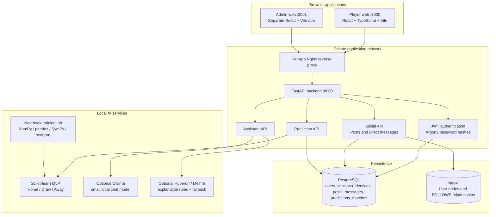

# PitchSide — target architecture and implemented boundaries

## Product goal

PitchSide evolves the existing 3D 5v5 browser game into a football community and prediction platform. The platform has two independent web frontends:

1. **Player web** — public registration and login, social feed, people discovery, mutual-follow direct messages, AI assistant, match prediction screen, profile/settings, and the preserved 5v5 game.
2. **Admin web** — a separate control-room frontend for authorized administrators. Its host port is bound to `127.0.0.1` in Docker Compose; the backend also checks the user's `admin` role for every admin metric request.

The API, PostgreSQL, Neo4j, and local model services are not frontends. They are services behind the web applications.

## System diagram

## Why this separation matters

### Existing football game

The game remains inside the player application under **Play game**. `GameEngine`, `GameLoop`, `Ball`, `Player`, `Collision`, `FootballRules`, and `OpponentAI` remain the real-time simulation. The existing `OpponentAI` is a deterministic/rule-based tactical controller with movement, positioning, goalkeeper, passing, tackling, and shooting logic. It is suitable for frame-by-frame movement decisions because it does not need a network request every frame.

### Match prediction model

A new CPU-only multilayer perceptron (MLP) predicts the result class of a fixture: `home`, `draw`, or `away`. This model is distinct from the game opponent. It consumes pre-match tabular features and does **not** control player movement. A real learned player-control policy would need a separate reinforcement-learning/simulation training project and is not claimed to exist here.

### Assistant and MeTTa

Ollama is an optional local natural-language assistant. Hyperon/MeTTa is an optional symbolic layer for transparent explanation rules. The current production-safe fallback is ordinary Python explanation logic. MeTTa is not the account security system, not a replacement for statistical training, and not allowed to approve privileged actions.

### Data ownership

- **PostgreSQL** is the source of truth for account records, password hashes, posts, messages, predictions and match results.
- **Neo4j** stores graph relationships such as `(:User)-[:FOLLOWS]->(:User)`. It must not store passwords, authentication tokens, or secrets.
- Model files are stored in the local `artifacts/` directory. Large datasets are kept in `data/`, not committed to Git.

## Implemented API surface

| Route | Purpose | Access |
|---|---|---|
| `POST /api/v1/auth/register` | Register a player | Public |
| `POST /api/v1/auth/login` | Obtain a JWT | Public |
| `GET /api/v1/auth/me` | Read current account | Signed in |
| `GET /api/v1/social/people` | Search active accounts | Signed in |
| `POST /api/v1/social/follow/{user_id}` | Create a follow edge | Signed in |
| `GET /api/v1/social/friends` | Find mutual follows | Signed in |
| `GET /api/v1/social/feed` | Read latest posts | Signed in |
| `POST /api/v1/social/posts` | Publish a post | Signed in |
| `GET /api/v1/social/messages?peer_id=...` | Read a conversation | Mutual follows |
| `POST /api/v1/social/messages` | Send a direct message | Mutual follows |
| `POST /api/v1/predictions` | Predict a match using the trained artifact | Signed in |
| `POST /api/v1/matches` | Save a completed game and its match statistics | Signed in |
| `GET /api/v1/matches/me` | Read the current player’s recent match history | Signed in |
| `POST /api/v1/assistant/chat` | Chat with local Ollama or fallback | Signed in |
| `GET /api/v1/admin/metrics` | User/system/model counters | Admin role only |
| `GET /api/v1/admin/users` | Read the latest 200 player accounts | Admin role only |
| `PATCH /api/v1/admin/users/{id}/status` | Enable or disable a player account | Admin role only |
| `GET /api/v1/health` | API/database/model status | Public health check |

## Important current limits

This repository is an implementation scaffold, not a finished production social network. The core account, social-post, mutual-follow chat, graph-follow, assistant, prediction, completed-match history, and admin metric paths are wired. The direct-message UI refreshes every five seconds rather than using WebSockets. Likes, comments, media uploads, moderation queues, password-reset email, email verification, multi-factor authentication, real-time notifications, external live-score feeds, and a trained in-game reinforcement-learning policy remain separate feature work. Do not describe those as implemented.
