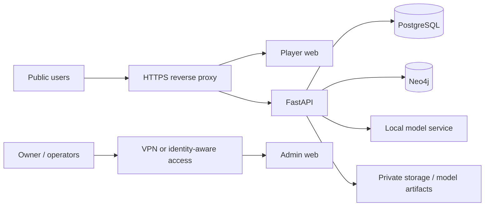

# Deployment guide

## Development vs internet-facing deployment

The included `docker-compose.yml` is a local-first development stack. It is useful for validating the two frontends and backend on one machine, but it is not a complete hardened production deployment.

For an internet-facing deployment, use a Linux VPS or cloud VM with Docker, persistent encrypted volumes, a firewall, HTTPS termination and automated backups. Publish only the player website and the public API paths required by it. Keep database, graph, Ollama and administrative services private.

## Recommended production topology

## Before deployment

1. Set `ENVIRONMENT=production` and a unique `JWT_SECRET`.
2. Use strong, independent PostgreSQL and Neo4j passwords.
3. Run Alembic migrations: `docker compose exec backend alembic upgrade head`.
4. Create the first admin, then remove `ADMIN_PASSWORD` from the runtime environment or rotate it after bootstrap.
5. Train and validate the prediction model with a dataset licensed for deployment.
6. Ensure Ollama is reachable from the backend if the local assistant is enabled. Otherwise leave it disabled and accept the safe fallback.
7. Configure HTTPS and a restrictive Content Security Policy, HSTS, rate limiting and request-size limits at the edge.
8. Back up and test restoring PostgreSQL, Neo4j and model artifacts.
9. Put `admin-web` behind a VPN/zero-trust identity proxy. Do not publish port 3001 directly.
10. Monitor logs, RAM, disk, API errors, model drift and prediction calibration.

## Reverse proxy and domains

Use separate hostnames if possible:

- `app.example.com` for the player application.
- `api.example.com` for the backend API, or serve `/api/` behind the same player origin.
- `admin.example.com` only behind an authenticated VPN/identity-aware proxy.

Configure TLS certificates and force HTTPS. Update `CORS_ORIGINS` to the exact required origin list. The development Docker Compose binds admin, database browsers and direct backend access to localhost; preserve that intent in production firewall rules.

## Model artifact deployment

Keep the trained model outside the frontend bundle. Mount the artifact read-only into the backend after it has been validated. Keep the data source, metadata, metrics and model version together. A model replacement should be evaluated before it is promoted; do not overwrite a model solely because a training run completed.

## Scale only when needed

For an 8 GB machine, keep the current CPU MLP, one LLM and limited database caches. Do not deploy 7B+ LLMs, image/video inference stacks, and large vector databases on this baseline. If usage grows, separate AI inference and databases onto dedicated machines rather than starving the game/API server.
